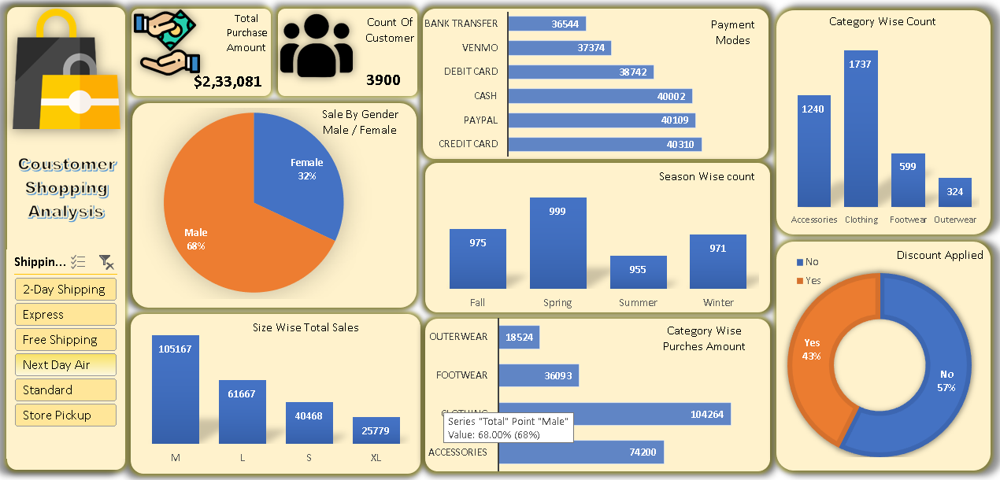

# Excel Data Analysis Dashboard

## Project Overview

An interactive Excel dashboard designed to analyze data and visualize key insights.

 
 

<h2 align="center">Dashboard Preview</h2>

  

## Tools Used
- Microsoft Excel
- Pivot Tables
- Pivot Charts
- Slicers

## Key Features
- Interactive dashboard
- Dynamic chart filtering using slicers
- Data summarization with Pivot Tables
- Visual analysis of important metrics

## Project Files
- Excel workbook (.xlsx)
- Dashboard screenshot (if available)

## Skills Demonstrated
Excel | Data Analysis | Data Visualization |
Pivot Tables | Dashboard Development
